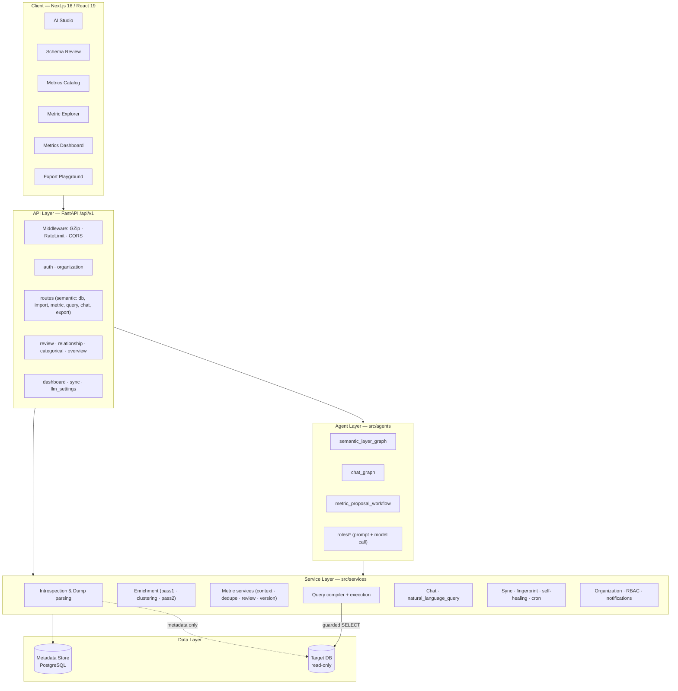
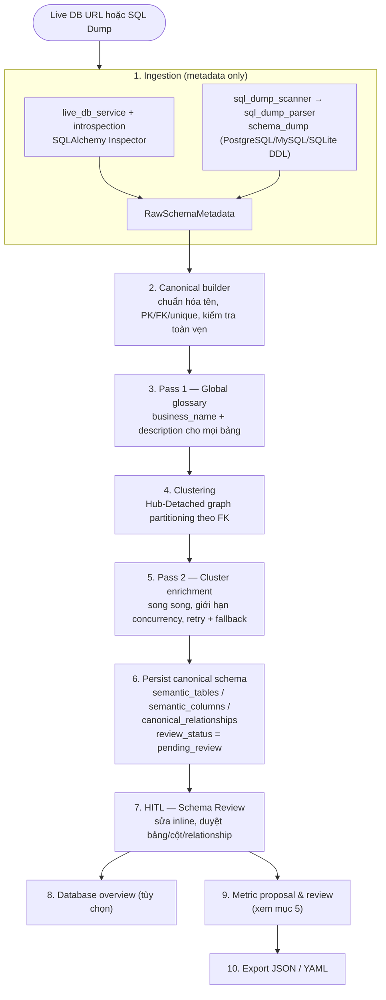
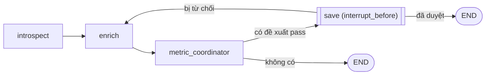
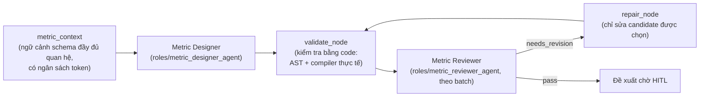
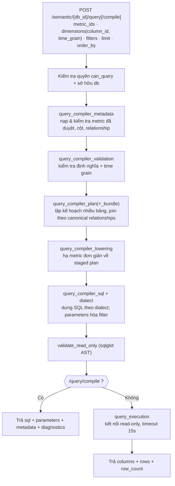
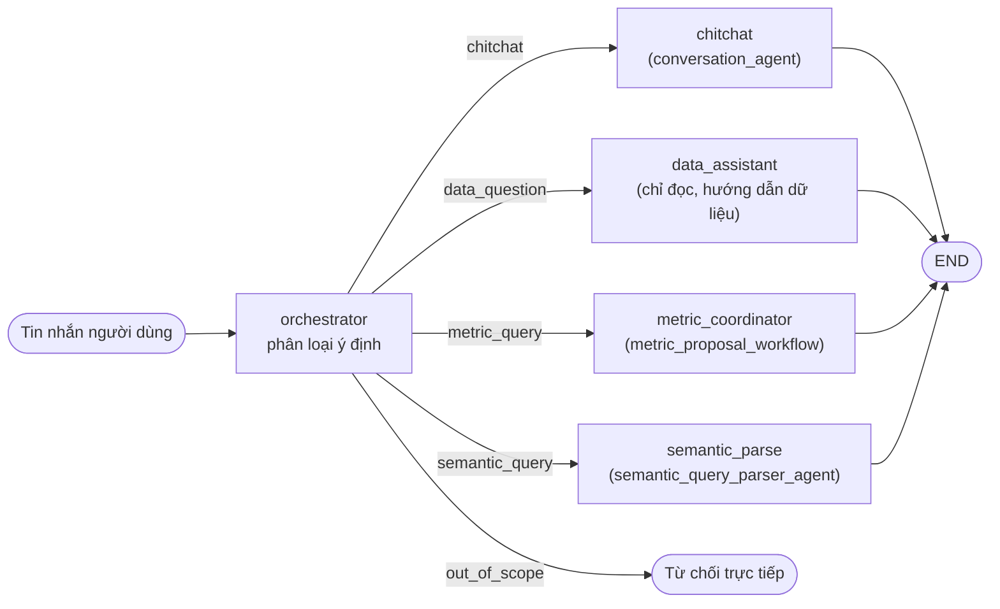
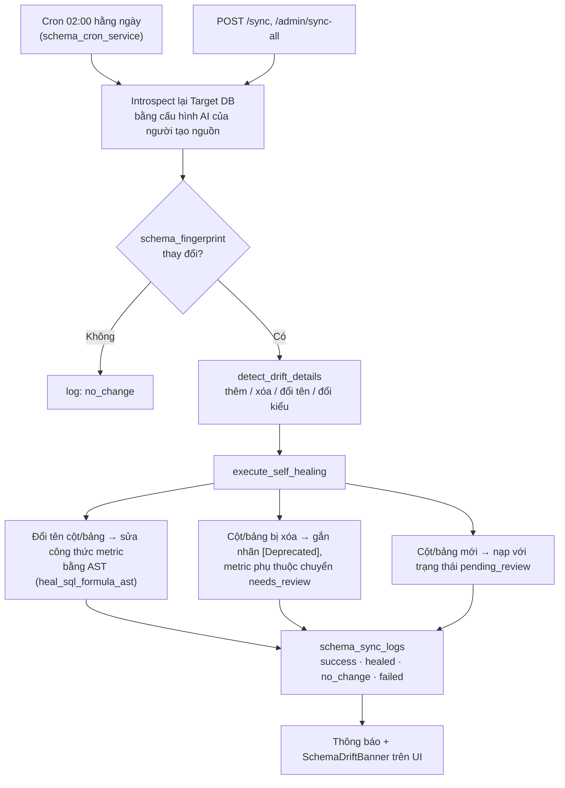
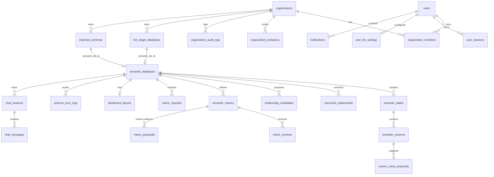
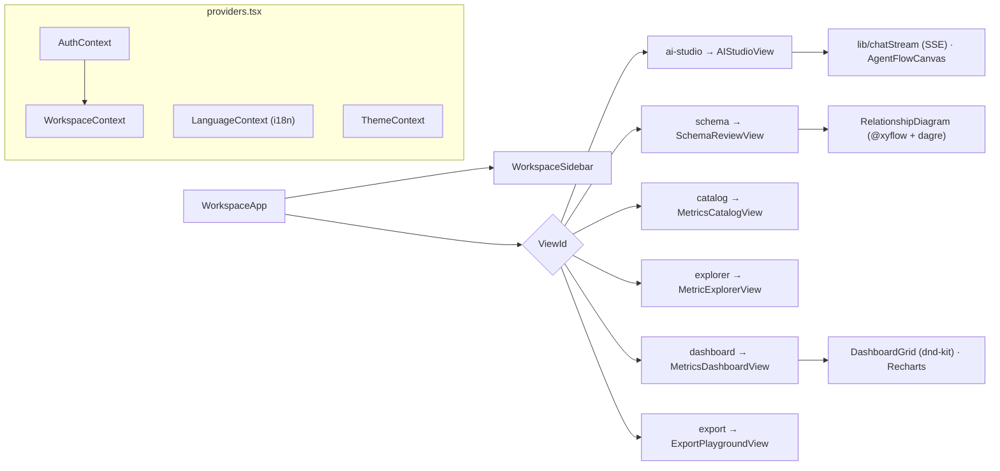
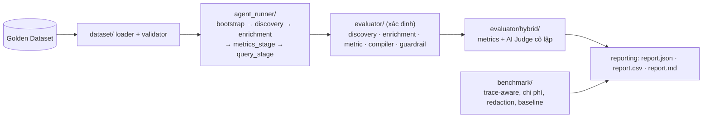

# Architecture — AI Semantic Layer Agent (P-069)

Tài liệu mô tả kiến trúc **hiện tại** của hệ thống. Hướng dẫn cài đặt và sử dụng: [README.md](README.md). Bản đồ từng file: [PROJECT_STRUCTURE.md](PROJECT_STRUCTURE.md). Thiết kế CSDL chi tiết: [docs/DATABASE_DESIGN.md](docs/DATABASE_DESIGN.md).

## Mục lục

1. [Tổng quan](#1-tổng-quan)
2. [Công nghệ](#2-công-nghệ)
3. [Kiến trúc phân tầng](#3-kiến-trúc-phân-tầng)
4. [Flow 1 — Generate & Manage](#4-flow-1--generate--manage)
5. [Vòng đời Metric & HITL](#5-vòng-đời-metric--hitl)
6. [Flow 2 — Semantic Query Engine](#6-flow-2--semantic-query-engine)
7. [AI Studio (Chat graph)](#7-ai-studio-chat-graph)
8. [Schema Sync & Self-healing](#8-schema-sync--self-healing)
9. [Mô hình dữ liệu](#9-mô-hình-dữ-liệu)
10. [Xác thực, Workspace & RBAC](#10-xác-thực-workspace--rbac)
11. [Cấu hình LLM](#11-cấu-hình-llm)
12. [Bảo mật & Guardrails](#12-bảo-mật--guardrails)
13. [Observability](#13-observability)
14. [Frontend](#14-frontend)
15. [Evaluation Framework](#15-evaluation-framework)
16. [Triển khai](#16-triển-khai)
17. [Quyết định thiết kế chính](#17-quyết-định-thiết-kế-chính)

---

## 1. Tổng quan

Hệ thống đóng vai trò cầu nối giữa **schema kỹ thuật** và **ngữ cảnh kinh doanh**:

- **Flow 1 — Generate & Manage:** introspect schema (Live DB hoặc SQL Dump) → LLM đề xuất tên nghiệp vụ tiếng Việt, mô tả, relationship và Business Metrics → con người duyệt (HITL) → lưu vào Metadata Store → export JSON/YAML.
- **Flow 2 — Semantic Query (chỉ Live DB):** `SemanticQueryCompiler` biên dịch metric/dimension/filter **đã duyệt** thành SQL read-only có guardrail. Không text-to-SQL tự do.
- **AI Studio:** đồ thị hội thoại LangGraph phân loại ý định và chuyển tới agent phù hợp; câu hỏi truy vấn được parse thành *lựa chọn metric/dimension đã duyệt* rồi đi qua compiler.
- **Quản trị:** workspace, RBAC, thông báo, đồng bộ schema, dashboard, cấu hình AI theo tài khoản.

Nguyên tắc xuyên suốt: *LLM đề xuất, con người quyết định, code xác định thực thi.*

## 2. Công nghệ

| Tầng | Công nghệ |
| --- | --- |
| Backend | Python 3.11, FastAPI (async), Pydantic v2, pydantic-settings |
| Agent | LangGraph, LangChain (`langchain-openai`, `langchain-anthropic`) |
| SQL | SQLAlchemy 2 async, `sqlglot` (AST validation, parse dump), asyncpg / asyncmy / aiosqlite / PyMySQL |
| Metadata Store | PostgreSQL 16 (Alembic migrations) |
| Bảo mật | Fernet (`cryptography`), JWT (`pyjwt`), bcrypt, Google OAuth |
| Observability | Langfuse, LangSmith, Prometheus |
| Frontend | Next.js 16 (App Router), React 19, TypeScript, Tailwind CSS 4, `@xyflow/react` + dagre, dnd-kit, Recharts |
| Test | pytest (backend), Vitest + Testing Library, Playwright (frontend) |
| Hạ tầng | Docker, Docker Compose, GitHub Actions |

## 3. Kiến trúc phân tầng

**Quy ước phân lớp**

| Lớp | Trách nhiệm | Không được làm |
| --- | --- | --- |
| `api/` | Xác thực, kiểm tra quyền, validate request, gọi service | Chứa logic nghiệp vụ nặng |
| `services/` | Logic nghiệp vụ, truy cập DB, compiler | Biết về HTTP |
| `agents/roles/` | Prompt, gọi model, ràng buộc output của từng agent | Ghi DB |
| `agents/nodes/` | Adapter `AgentState` ↔ role/service | Chứa prompt |
| `agents/graphs`, `workflows/` | Lắp ráp node/edge, routing | Chứa logic LLM |
| `models/` | ORM và contract Pydantic dùng chung | Truy vấn DB |

### Thành phần backend khởi động (`src/main.py`)

- Middleware: `GZipMiddleware` (≥ 1000 byte), `RateLimitMiddleware` (in-memory, bật khi `RATE_LIMIT_ENABLED` hoặc `APP_ENV=production`), `CORSMiddleware`.
- Routers gắn dưới `/api/v1`; nhóm `routes`, `review`, `overview`, `sync` có dependency `use_account_llm` để mọi lời gọi LLM trong request dùng cấu hình AI của tài khoản đang đăng nhập.
- `lifespan`: khởi động cron đồng bộ schema (trừ `APP_ENV=test`), tắt tracing khi dừng.
- `GET /health`, `/metrics` (nếu đã cài `prometheus-fastapi-instrumentator`).

## 4. Flow 1 — Generate & Manage

### 4.1. Ingestion

| Nguồn | Thành phần | Ghi chú |
| --- | --- | --- |
| Live DB | `live_db_service.py`, `introspection.py`, `unique_key_metadata.py`, `tls.py`, `target_db_privileges.py` | Chỉ `get_tables` / `get_columns` / `get_foreign_keys` / unique constraints. Kiểm tra tài khoản chỉ đọc. Hỗ trợ TLS và mTLS |
| SQL Dump | `sql_dump_scanner*.py`, `sql_dump_parser*.py`, `schema_dump.py`, `schema_ingestion.py` | Bộ quét từ vựng có giới hạn (20 MB/file, 1 MB/statement, độ sâu lồng, số diagnostics) để chống dump độc hại |

Cả hai nguồn quy về **`RawSchemaMetadata`** (`models/raw_schema.py`, `models/schema_metadata.py`) — contract chung cho mọi adapter và AI node. `schema_normalization.py` đảm bảo kết quả xác định (thứ tự, tên chuẩn hóa); `schema_fingerprint.py` băm schema để phát hiện drift.

### 4.2. Enrichment hai pass

| Bước | Module | Mô tả |
| --- | --- | --- |
| Pass 1 | `pass1_global_glossary.py` | Gọi LLM theo batch (`pass1_batch_size`) trên toàn bộ tên bảng, gộp thành glossary chung |
| Clustering | `clustering.py` | Phân hoạch đồ thị bảng theo FK (Hub-Detached) để mỗi cụm đủ nhỏ cho ngữ cảnh LLM |
| Pass 2 | `pass2_cluster_enrichment.py`, `llm_caller.py` | Làm giàu từng cụm song song; semaphore, retry, fallback khi LLM lỗi |
| Điền chỗ trống | `semantic_fill.py` | Chỉ điền ô còn trống; không ghi đè nội dung người dùng đã sửa/duyệt |
| Cấu hình | `enrichment_config.py` | `max_tables_per_cluster=6`, `max_cols_per_cluster=45`, `max_concurrency=3`, `retry_max_attempts=2` |
| Tiến độ | `enrichment_progress.py` | Registry in-memory phục vụ `GET /semantic/{db_id}/enrich/status` |

`POST /semantic/generate` trả `202` ngay và chạy nền; frontend poll tiến độ (`EnrichmentProgressBanner`). Persist qua `semantic_service.enrich_and_save_canonical_schema`.

### 4.3. LangGraph Flow 1 (`agents/graphs/semantic_layer_graph.py`)

Graph biên dịch với `interrupt_before=["save"]`: dừng chờ HITL, nếu đặt `hitl_approved` thì lưu, nếu từ chối thì quay lại `enrich`. `AgentState` (`agents/state.py`) là TypedDict chung. Đường dùng chính trong sản phẩm là các route + service (enrichment nền, review UI); graph này giữ vai trò pipeline tham chiếu và được test riêng.

### 4.4. Review cấp schema

- Mỗi bảng/cột/relationship có `review_status` (`pending_review` → `approved`; relationship thêm `disabled`, `needs_review`) qua `models/review_mixin.py`.
- `schema_review_service.py` + `review_routes.py`: lấy dữ liệu review, sửa hàng loạt, **cổng phê duyệt** (`/schema/approve`).
- **Relationship:** `relationship_sync.py` đối chiếu FK vật lý mà không ghi đè quyết định của người dùng; `relationship_suggestions.py` gợi ý bằng AI *chỉ dựa metadata*, được `relationship_validation.py` kiểm tra trước khi ghi vào `relationship_candidates` (tách khỏi graph đang phục vụ); `relationship_review_service.py` xử lý vòng đời giao dịch và đánh giá tác động lên metric đã publish; `relationship_runtime.py` định nghĩa điều kiện và hướng duyệt đồ thị khi compile.
- **Giá trị cột:** `categorical_value_discovery.py` (opt-in, có giới hạn), `categorical_discovery_policy.py` (điều kiện đủ), `categorical_proposals.py` lưu đề xuất vào `column_value_proposals` tách biệt khỏi metadata đã duyệt; `semantic_value_mappings.py` / `value_mapping_import.py` quản lý ánh xạ giá trị nghiệp vụ.

## 5. Vòng đời Metric & HITL

### 5.1. Sinh metric (Metric Proposal Workflow)

`agents/workflows/metric_proposal_workflow.py` là coordinator LangGraph có giới hạn vòng lặp:

- LLM **không sinh SQL**: nó trả `MetricDefinition` có cấu trúc (`models/metric_definition.py`, `metric_agent_output.py`); `metric_definition_resolver.py` ánh xạ tham chiếu sang metadata chuẩn; `metric_review_validation.py` kiểm tra bằng metadata và AST do compiler thực sự tạo ra.
- Các trạng thái kết quả mỗi item: `pass`, `needs_revision`, `needs_clarification`, `rejected`, `unsupported`, `error`, kèm mã lý do (`MISSING_GRAIN`, `VARIANT_CONFLICT`, `TECHNICAL_VALIDATION`, …) phục vụ trace và thống kê.
- **Dedupe:** `metric_dedupe.py` đối chiếu metric đã lưu (chưa soft-delete) trước khi đề xuất mới; người dùng có thể dùng lại metric tương đương (`reuse_metric_id`).
- **Tri thức KPI** (tùy chọn): `metric_knowledge.py` nạp `src/knowledge/retail_metrics.yaml` (không truy cập web).
- Bằng chứng review lưu trong `metric_proposals` (`metric_proposals.py`) để người duyệt thấy lý do.

### 5.2. Trạng thái & phiên bản

| Thực thể | Trạng thái | Nguồn |
| --- | --- | --- |
| `semantic_metrics.status` | `draft`, `pending_approval`, `needs_review`, `approved`, `unverified`, `rejected` | `ck_semantic_metrics_status` |
| `metric_versions.status` | `pending_approval`, `needs_review`, `approved`, `superseded`, `rejected` | ràng buộc trong `db.py` |

- **Append-only versioning** (`metric_versioning.py`): sửa metric tạo phiên bản mới (copy-on-write, `metric_service.py`); phiên bản đã duyệt không bị ghi đè. `metric_rollback.py` hoàn nguyên *không phá hủy* bằng cách tạo phiên bản mới từ phiên bản cũ. `metric_comparison.py` so sánh xác định giữa các metric.
- **Metric request:** `Member` gửi yêu cầu (`metric_request_service.py`), `Data Lead` duyệt/từ chối; thông báo lưu trong `notifications` và đẩy tới client qua `notification_bus.py` + `notification_stream.py` (SSE); `review_notifications.py` đồng bộ idempotent các thông báo "đang chờ duyệt".
- **Xóa mềm:** `semantic_metrics.is_deleted`; có thể `restore`.
- `approved_metric_definition.py` hiển thị định nghĩa đã duyệt bằng code, không dùng LLM.

## 6. Flow 2 — Semantic Query Engine

### 6.1. Module compiler

| Module | Vai trò |
| --- | --- |
| `query_compiler.py` | API công khai: `SemanticQueryCompiler`, `CompiledQuery`, `validate_read_only` |
| `query_compiler_orchestration.py` | Điều phối chuẩn bị metadata và render SQL |
| `query_compiler_metadata.py` | Nạp/kiểm tra metadata phục vụ compile |
| `query_compiler_validation.py` | Kiểm tra định nghĩa metric và time grain được chọn |
| `query_compiler_plan.py`, `query_compiler_plan_bundle.py` | Kế hoạch metric đa bảng; ghép nhiều metric trên cùng grain đầu ra |
| `query_compiler_lowering.py` | Hạ canonical simple metric về staged plan |
| `query_compiler_sql.py` | Dựng chuỗi SQL thuần (không truy cập DB) |
| `query_compiler_dialect.py` | Time bucket theo dialect (PostgreSQL/MySQL/SQLite) |
| `query_compiler_parameters.py` | Ép kiểu và bind tham số filter theo kiểu cột |
| `query_compiler_trace.py` | Trace compile có phiên bản (phục vụ evaluation) |
| `query_compiler_types.py`, `semantic_compile_error.py` | Kiểu kết quả và lỗi có mã (`read_only_violation`, `multi_statement`, `invalid_sql`, …) |
| `query_execution.py` | Thực thi `SELECT` đã biên dịch qua adapter async read-only |

### 6.2. Guardrail thực thi

1. **AST:** `sqlglot.parse` phải trả đúng 1 statement là `SELECT`; chặn `SELECT INTO`, CTE chứa DML, DDL.
2. **`LIMIT`:** mặc định 100, tối đa 1000 (ràng buộc ở `SemanticQueryRequest.limit`).
3. **Timeout 15 giây:** PostgreSQL `SET LOCAL statement_timeout`; MySQL `MAX_EXECUTION_TIME`; SQLite dùng progress handler.
4. **Tham số hóa:** giá trị filter được bind, không nối chuỗi.
5. **Kết nối chỉ đọc:** tài khoản bị kiểm tra quyền khi kết nối; PostgreSQL ép `default_transaction_read_only = on`.

## 7. AI Studio (Chat graph)

| Thành phần | Mô tả |
| --- | --- |
| `roles/orchestrator_agent.py` | Phân loại ý định |
| `roles/data_assistant_agent.py` | Trả lời hướng dẫn dữ liệu cho Member/Data Lead, chỉ đọc |
| `roles/semantic_query_parser_agent.py` | Parse câu hỏi thành `SemanticQueryInterpretation` (metric, dimension, filter, làm rõ) — chỉ chọn từ danh mục đã duyệt |
| `services/natural_language_query.py` | Dựng catalog cho parser, chuẩn hóa/xác thực lựa chọn (dimension có thể với tới từ metric, giá trị filter qua value mapping), hỏi lại khi mơ hồ; sau đó gọi compiler |
| `services/semantic_query_parser_context.py`, `semantic_query_values.py` | Chuẩn bị prompt riêng tư (không lộ fingerprint) và resolve giá trị filter theo mapping đã duyệt |
| `services/chat_service.py` | Lưu `chat_sessions` / `chat_messages`, kiểm tra quyền |
| `services/chat_tasks.py` | Giữ tác vụ chạy khi trình duyệt ngắt kết nối, gộp retry theo `client_message_id` |
| `services/chat_execution.py`, `chat_trace_storage.py` | Tiến độ thực thi an toàn (allowlist) và lưu trace vào `metadata_json.execution_trace` |

**Streaming:** `POST /chat/stream` trả SSE `snapshot` → `progress` → `result` | `error`. Kết nối lại với cùng `client_message_id` để tiếp tục tác vụ; `POST /chat/cancel` để hủy. Task đang chạy chỉ khôi phục được trong cùng một worker backend.

## 8. Schema Sync & Self-healing

- `schema_self_healing_service.py` không xóa dữ liệu đã duyệt: mục bị xóa khỏi nguồn được gắn nhãn `[Deprecated]` và trở lại `pending_review`; mục mới vào hàng chờ review để con người quyết định.
- `GET /sync-status` kiểm tra drift nhanh bằng fingerprint không cần LLM.

## 9. Mô hình dữ liệu

Metadata Store có **24 bảng ORM** (PostgreSQL) quản lý bằng Alembic.

| Nhóm | Bảng | Ghi chú |
| --- | --- | --- |
| Định danh & workspace | `users`, `user_sessions`, `organizations`, `organization_members`, `organization_invitations`, `organization_audit_logs` | Vai trò `admin` / `data_lead` / `member` (ràng buộc CHECK) |
| Nguồn dữ liệu | `live_target_databases`, `imported_schemas` | Connection URL mã hóa Fernet; cột TLS |
| Semantic metadata | `semantic_databases`, `semantic_tables`, `semantic_columns`, `canonical_relationships` | Tên bảng có schema; `review_status`; `row_count_approx` |
| Metric | `semantic_metrics`, `metric_versions`, `metric_proposals`, `metric_requests` | `metric_definition_json` (MetricDefinition v2); lưu lý do từ chối |
| Review bổ sung | `relationship_candidates`, `column_value_proposals` | Tách khỏi dữ liệu đã duyệt |
| Vận hành | `schema_sync_logs`, `notifications`, `dashboard_layouts` | Dashboard singleton theo database, khóa lạc quan |
| Chat & AI | `chat_sessions`, `chat_messages`, `user_llm_settings` | `client_message_id` để idempotent; key LLM mã hóa |

> ERD trên là sơ đồ khái niệm. Tên cột, khóa và ràng buộc chính xác nằm ở `src/models/db*.py` và `alembic/versions/`.

### Migration

- Mọi thay đổi schema → migration mới (`alembic revision --autogenerate`); không sửa migration đã apply.
- Revision ID phải duy nhất; kiểm tra `alembic heads` (chỉ 1 head) và `tests/test_migrations/test_revision_graph.py`.
- Nhánh song song được hợp nhất bằng migration merge không đổi schema.

## 10. Xác thực, Workspace & RBAC

- **Xác thực:** email/username + mật khẩu (bcrypt), Google OAuth ID token; JWT access + refresh, refresh token xoay vòng và thu hồi khi logout (`api/auth.py`).
- **Workspace:** `organization_service.py` quản lý tổ chức, thành viên, lời mời (token, chấp nhận), audit log. Mọi tài nguyên (nguồn dữ liệu, metric…) gắn với workspace sở hữu.
- **RBAC** (`ROLE_PERMISSIONS`):

| Quyền | admin | data_lead | member |
| --- | :-: | :-: | :-: |
| Quản lý thành viên / lời mời | ✔ | — | — |
| Quản lý schema (review, sync) | — | ✔ | — |
| Duyệt / quản lý metric | — | ✔ | — |
| Gửi metric / metric request | — | ✔ | ✔ |
| Query, Chat, Data Assistant | ✔ | ✔ | ✔ |
| Metric Studio (AI sinh metric) | — | ✔ | — |
| Xem metric chờ duyệt | — | ✔ | — |
| Export | — | ✔ | — |

Kiểm tra bằng `require_permission(membership, permission)` trong tầng service/route. Xem `ROLE_PERMISSIONS` để biết danh sách quyền chính xác nhất.

## 11. Cấu hình LLM

- **Một cổng duy nhất:** mọi agent lấy model qua `get_llm()` (`services/llm.py`), `temperature = 0.0`, prompt đặt tên nghiệp vụ yêu cầu tiếng Việt. Không khởi tạo `ChatOpenAI` ở nơi khác.
- **Provider:** preset `openai`, `gemini`, `groq`, `mimo`, `anthropic`, `openrouter`, `deepseek`… hoặc tên tùy ý kèm `LLM_API_BASE`. Giao thức `openai` (mặc định, mọi endpoint OpenAI-compatible) hoặc `anthropic` (native).
- **Theo tài khoản:** `llm_settings_service.py` + `models/llm_settings.py` lưu key mã hóa Fernet; dependency `use_account_llm` đặt client theo request (ContextVar). Tác vụ nền dùng cấu hình của người tạo nguồn dữ liệu.
- **Model theo vai trò:** `LLM_MODEL_ENRICH`, `LLM_MODEL_METRIC`.
- **Runtime metric:** `metric_runtime.py` — một chính sách provider có giới hạn, không retry lồng của SDK.
- **Judge cô lập:** `role="judge"` yêu cầu `JUDGE_*` riêng, khác provider/model/key của agent; không có fallback credential.

## 12. Bảo mật & Guardrails

| Mối đe dọa | Biện pháp |
| --- | --- |
| Lộ connection URL / API key | Fernet; không log; không trả về qua API; handler validation che lỗi cấu hình LLM |
| Ghi/xóa dữ liệu Target DB | Flow 1 chỉ metadata; Flow 2 chỉ `SELECT` qua AST; kiểm tra quyền tài khoản; session read-only |
| Truy vấn nặng/vô hạn | `LIMIT` ≤ 1000, timeout 15s |
| SQL injection | Compiler xác định, tham số hóa filter; không `eval/exec` SQL; relationship preview là SQL an toàn do hệ thống dựng, request không nhận SQL |
| Dump độc hại | Giới hạn kích thước file, statement, độ sâu, số diagnostics |
| Truy cập chéo workspace | Ràng buộc sở hữu tài nguyên theo tổ chức + RBAC |
| Lạm dụng AI | Rate limit theo RPM cho endpoint AI |
| Rò rỉ qua observability | Trace chỉ lưu tóm tắt do server kiểm soát; benchmark redact trước khi lưu |
| Hallucination | LLM chỉ đề xuất; validate bằng code + AST + compiler; HITL duyệt trước khi dùng; Flow 2 không nhận SQL từ LLM |

## 13. Observability

- `observability/agent_trace.py`: sự kiện trace agent opt-in, tách biệt với lưu trữ benchmark.
- `observability/langfuse_tracing.py`: xuất observation của agent với bản tóm tắt có giới hạn (`LANGFUSE_*`).
- `observability/llm_usage.py`: chuẩn hóa usage metadata của provider (token, chi phí) cho benchmark; `DELETE /settings/llm/usage` xóa dữ liệu usage theo tài khoản.
- LangSmith tự tắt nếu không có key hợp lệ; Prometheus qua `/metrics` nếu có instrumentator.

## 14. Frontend

Next.js App Router (`frontend/src/app`): landing `/`, `(auth)/login|register`, `workspace`, `invite/[token]`.

- `lib/api.ts`: client REST tập trung (`NEXT_PUBLIC_API_URL` hoặc `NEXT_PUBLIC_API_BASE_URL`); các module `lib/*Api.ts`, `chatStream.ts`, `notificationStream.ts` xử lý SSE.
- Thông báo realtime (`NotificationCenter`), banner drift (`SchemaDriftBanner`), chuyển ngôn ngữ và theme sáng/tối.
- Kiểm thử: Vitest (cùng thư mục với component, `*.test.tsx`) và Playwright (`frontend/e2e`).

## 15. Evaluation Framework

`eval/` đánh giá agent trên **Golden Dataset** (`eval/golden_dataset/ecommerce/`) qua 5 stage:

Chạy trên sandbox SQLite cô lập (không chạm Target DB thật). Chi tiết: [eval/README.md](eval/README.md). Có thêm benchmark relationship (`eval/relationship_benchmark.py`) và đánh giá semantic parser (`eval/run_semantic_parser_eval.py`).

## 16. Triển khai

| Môi trường | Cách chạy |
| --- | --- |
| Phát triển cục bộ | `uvicorn` + `npm run dev`; PostgreSQL bằng `infra/docker-compose.dev.yml` (`postgres`, `pgadmin`) |
| Dev trong container | `infra/docker-compose.dev.yml` thêm `backend` hot-reload + debugpy `5678` |
| Trọn gói | `infra/docker-compose.yml`: `postgres` + `backend` (chạy `alembic upgrade head` rồi `uvicorn`) + `frontend` (cổng 3000) |
| Test compiler đa DB | `infra/docker-compose.compiler-test.yml` (PostgreSQL + MySQL fixture) |
| CI/CD | GitHub Actions: `test.yml`, `build.yml`, `security.yml`, `gitops.yml`, `main.yml` |

Backend được thiết kế **stateless** trừ ba thành phần in-memory chỉ có hiệu lực trong một worker: registry tiến độ enrichment, task chat đang chạy và rate limiter. Khi scale ngang cần sticky session hoặc thay bằng kho chung.

## 17. Quyết định thiết kế chính

| Quyết định | Lý do |
| --- | --- |
| Compiler xác định thay vì text-to-SQL | Kiểm soát, tái lập, không ảo giác, dễ audit |
| LLM không sinh SQL cho metric | Metric là cấu trúc `MetricDefinition`; SQL do compiler dựng và kiểm bằng AST |
| HITL ở mọi điểm LLM tạo tri thức | Metric/schema chỉ dùng cho Flow 2 sau khi duyệt |
| Phiên bản metric append-only + rollback không phá hủy | Giữ lịch sử và khả năng kiểm toán |
| Candidate (relationship, giá trị cột) tách khỏi dữ liệu đã duyệt | Đề xuất AI không ảnh hưởng truy vấn cho đến khi được duyệt |
| Pass 1 → clustering → pass 2 | Giữ ngữ cảnh LLM nhỏ và nhất quán cho schema lớn |
| Fingerprint + self-healing | Đồng bộ nhanh, tự sửa công thức khi đổi tên mà không mất metric đã duyệt |
| Cấu hình LLM theo tài khoản | Mỗi người dùng/tổ chức tự quản key, không cần restart |
| Judge cô lập trong evaluation | Tránh tự chấm điểm chính mình |
| Không dùng vector store | Ràng buộc dự án; ngữ cảnh lấy từ metadata có cấu trúc |
