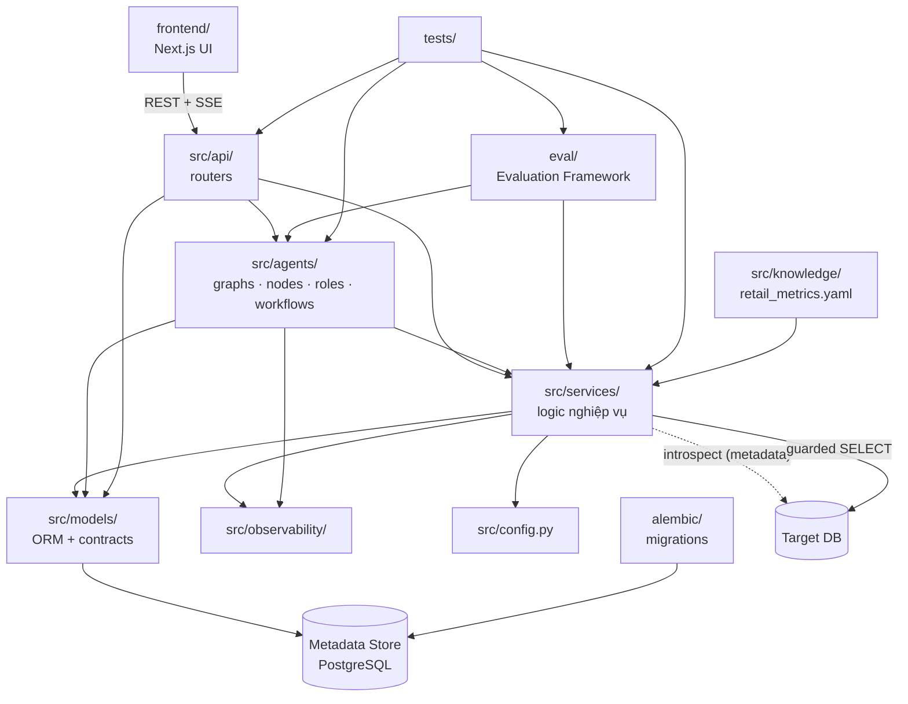
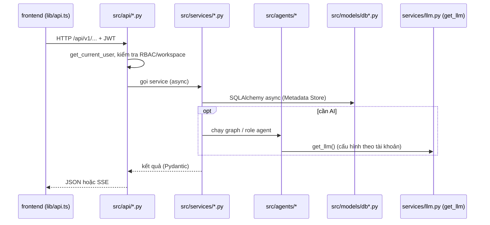
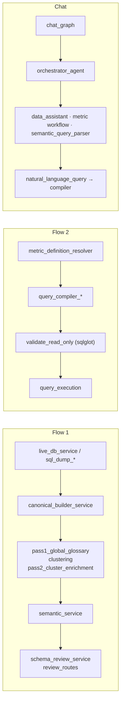

# Bản đồ cấu trúc dự án — AI Semantic Layer Agent (P-069)

Tài liệu này liệt kê **cây thư mục, từng file và vai trò của chúng**. Tổng quan sản phẩm: [README.md](README.md). Kiến trúc và luồng xử lý: [ARCHITECTURE.md](ARCHITECTURE.md).

> Mô tả file được lấy từ docstring/nội dung code tại thời điểm viết. Khi thêm file mới, cập nhật bảng tương ứng. Các thư mục sinh tự động (`__pycache__`, `node_modules`, `.venv`, `.next`, `test-results`) không được liệt kê.

## Mục lục

1. [Sơ đồ tổng thể](#1-sơ-đồ-tổng-thể)
2. [Cây thư mục cấp cao](#2-cây-thư-mục-cấp-cao)
3. [Backend `src/`](#3-backend-src)
4. [Frontend `frontend/`](#4-frontend-frontend)
5. [Migrations `alembic/`](#5-migrations-alembic)
6. [Evaluation `eval/`](#6-evaluation-eval)
7. [Tests `tests/`](#7-tests-tests)
8. [Hạ tầng, script, dữ liệu, tài liệu](#8-hạ-tầng-script-dữ-liệu-tài-liệu)
9. [File gốc & cấu hình](#9-file-gốc--cấu-hình)

---

## 1. Sơ đồ tổng thể

### 1.1. Phụ thuộc giữa các khối



### 1.2. Dòng điều khiển một request điển hình



### 1.3. Ba pipeline và file chủ chốt



---

## 2. Cây thư mục cấp cao

```
P-069/
├── src/                     Backend FastAPI + LangGraph
│   ├── main.py              Điểm vào ứng dụng
│   ├── config.py            Settings
│   ├── api/                 Routers (HTTP)
│   ├── agents/              Đồ thị & agent LLM
│   │   ├── graphs/          Lắp ráp LangGraph
│   │   ├── nodes/           Adapter state → role/service
│   │   │   ├── chat/
│   │   │   ├── metric/
│   │   │   └── schema/
│   │   ├── roles/           Prompt + gọi model của từng agent
│   │   ├── workflows/       Workflow metric có giới hạn vòng lặp
│   │   └── state.py         AgentState
│   ├── services/            Logic nghiệp vụ (≈ 100 module)
│   ├── models/              ORM + contract Pydantic
│   ├── observability/       Langfuse, trace, usage
│   └── knowledge/           retail_metrics.yaml
├── frontend/                Next.js 16 + React 19
│   ├── src/app/             Route (App Router)
│   ├── src/components/      UI theo miền
│   ├── src/context/         Auth, Workspace, Language, Theme
│   ├── src/lib/             API client, SSE, helper
│   ├── src/i18n/            Từ điển ngôn ngữ
│   ├── src/test/            Fixture/setup Vitest
│   └── e2e/                 Playwright
├── alembic/                 Migration CSDL (versions/)
├── eval/                    Evaluation Framework
│   ├── dataset/ evaluator/ agent_runner/ benchmark/
│   └── golden_dataset/      Dữ liệu chuẩn (ecommerce)
├── tests/                   pytest (agents, api, services, models, migrations, ...)
├── infra/                   Dockerfile, docker-compose, pgAdmin
├── scripts/                 Seed, import, TLS, logging hooks
├── data/                    Golden Retail schema + seed
├── docs/                    Tài liệu dự án
├── .github/workflows/       CI/CD
├── .claude/                 Lệnh /check, /new-migration, cấu hình
└── (file gốc)               README, ARCHITECTURE, AGENTS, CLAUDE, Makefile, requirements*, ...
```

---

## 3. Backend `src/`

### 3.1. Gốc

| File | Vai trò |
| --- | --- |
| `src/main.py` | Tạo `FastAPI`: middleware (GZip, rate limit, CORS), gắn router dưới `/api/v1`, `lifespan` (khởi/tắt cron sync, tắt tracing), `/health`, `/metrics` |
| `src/config.py` | `Settings` (pydantic-settings, đọc `.env`): app, CORS, JWT secret, rate limit, LLM/Judge, giới hạn SQL dump, `DATABASE_URL`, `ENCRYPTION_KEY`, `TARGET_DB_REQUIRE_READ_ONLY`; `get_settings()` / `reload_settings()` |
| `src/knowledge/retail_metrics.yaml` | Công thức KPI bán lẻ có nguồn dẫn, nạp bởi `metric_knowledge.py` khi `METRIC_KNOWLEDGE_ENABLED` |

### 3.2. `src/api/` — Routers

| File | Vai trò |
| --- | --- |
| `auth.py` | Đăng ký, đăng nhập, Google OAuth, refresh token xoay vòng, logout, `get_current_user`, mã hóa mật khẩu |
| `organization_routes.py` | Workspace, thành viên, lời mời, thông báo (kể cả SSE stream) |
| `routes.py` | Router lớn nhất của miền `/semantic`: kết nối Live DB, import SQL Dump, generate (enrichment nền), catalog, metric CRUD/generate, query/compile, chat/stream, export, sửa inline |
| `review_routes.py` | Cổng HITL: duyệt schema, quyết định phiên bản metric (approve/reject/pending-version) |
| `relationship_review_routes.py` | Relationship: suggest, candidates, preview, edit, disable, impact |
| `categorical_routes.py` | Đề xuất giá trị cột và value mappings, quản lý quyền duyệt tách khỏi metadata schema |
| `overview_routes.py` | Xem/sinh/duyệt mô tả tổng quan database |
| `dashboard_routes.py` | Layout dashboard singleton theo database |
| `sync_routes.py` | Kiểm tra drift, trigger sync, sync logs, `admin/sync-all` |
| `llm_settings_routes.py` | Cấu hình AI theo tài khoản, tải danh sách model, `use_account_llm` |

### 3.3. `src/agents/` — Agent & đồ thị

| File | Vai trò |
| --- | --- |
| `state.py` | `AgentState` (TypedDict) dùng chung cho graph |
| `graphs/semantic_layer_graph.py` | Flow 1: `introspect → enrich → metric_coordinator → save` (interrupt trước `save` để HITL) |
| `graphs/chat_graph.py` | Chat: `orchestrator` → `chitchat` / `data_assistant` / `metric_coordinator` / `semantic_parse` |
| `workflows/metric_proposal_workflow.py` | Coordinator có giới hạn: builder → validate → reviewer theo batch → repair |

**`nodes/` — adapter giữa `AgentState` và agent/service**

| File | Vai trò |
| --- | --- |
| `nodes/chat/orchestrator_node.py` | Gọi Orchestrator Agent |
| `nodes/chat/conversation_node.py` | Gọi Conversation Agent (chitchat) |
| `nodes/chat/data_assistant_node.py` | Gọi Data Assistant Agent |
| `nodes/chat/semantic_query_parser_node.py` | Gọi Semantic Query Parser Agent |
| `nodes/metric/coordinator_node.py` | Chạy metric coordinator với đủ bằng chứng của request |
| `nodes/metric/validate_node.py` | Kiểm tra bằng code đầu ra của Metric Designer trước khi tới Reviewer |
| `nodes/metric/metric_review_node.py` | Chặn đề xuất trước khi tới HITL/lưu |
| `nodes/metric/repair_node.py` | Chỉ sửa candidate được coordinator chọn |
| `nodes/metric/metric_node_helpers.py` | Cập nhật state khi workflow thất bại |
| `nodes/schema/introspect_node.py` | Flow 1 bước 1: introspect schema |
| `nodes/schema/enrich_node.py` | Flow 1 bước 2: gọi Schema Enrichment Agent |
| `nodes/schema/save_node.py` | Flow 1 bước 5: lưu sau khi HITL duyệt |

**`roles/` — mỗi agent LLM (prompt, gọi model, ràng buộc output)**

| File | Vai trò |
| --- | --- |
| `orchestrator_agent.py` | Phân loại yêu cầu chat |
| `conversation_agent.py` | Trả lời chào hỏi và câu hỏi chung được hỗ trợ |
| `data_assistant_agent.py` | Hướng dẫn dữ liệu chỉ đọc cho Member/Data Lead |
| `schema_enrichment_agent.py` | Sinh `business_name` + `description` tiếng Việt |
| `metric_designer_agent.py` | Soạn/sửa định nghĩa metric bám schema |
| `metric_reviewer_agent.py` | Đánh giá theo batch các định nghĩa đã hợp lệ kỹ thuật |
| `metric_prompt_rules.py` | Ràng buộc chung cho designer và reviewer |
| `semantic_query_parser_agent.py` | Parse câu hỏi thành `SemanticQueryInterpretation` |
| `semantic_query_parser_integration.py` | Đưa metadata mapping đã duyệt vào prompt parser (không lộ fingerprint) |

### 3.4. `src/models/` — ORM & contract

| File | Vai trò |
| --- | --- |
| `db_base.py` | Declarative base và cột dùng chung |
| `db.py` | ORM chính: người dùng, phiên, workspace/thành viên/lời mời/audit, nguồn dữ liệu, semantic db/table/column, metric + version, relationships, request, notification, dashboard, sync log, … |
| `db_chat.py` | `chat_sessions`, `chat_messages` |
| `db_metric_proposals.py` | `metric_proposals` — bằng chứng review của metric AI |
| `db_relationships.py` | `relationship_candidates` — đề xuất tách khỏi graph phục vụ |
| `db_categorical_proposals.py` | `column_value_proposals` — giá trị quan sát được chờ duyệt |
| `llm_settings.py` | `user_llm_settings` (key mã hóa) + contract công khai |
| `review_mixin.py` | Cột `review_status` dùng chung cho bảng/cột/quan hệ |
| `raw_schema.py` | Contract schema thô cho adapter trích xuất và AI node |
| `schema_metadata.py` | Contract schema canonical dùng chung cho mọi nguồn |
| `metric_definition.py` | `MetricDefinition` v2 — hợp đồng giữa sinh, lưu và biên dịch metric |
| `metric_agent_output.py` | Bản nháp metric phía provider (không chứa metadata do backend sở hữu) |
| `metric_review.py` | Contract đề xuất metric chưa lưu đã review |
| `relationship_review.py` | Contract API relationship (cấm nhận SQL trong input) |
| `review_schemas.py` | Request/response cổng review schema |
| `schemas.py` | Pydantic request/response cho hầu hết API (auth, live DB, query, chat, dashboard, …) |
| `tls_settings.py` | Enum và model cấu hình TLS cho kết nối DB |

### 3.5. `src/observability/`

| File | Vai trò |
| --- | --- |
| `agent_trace.py` | Sự kiện trace agent opt-in, tách khỏi lưu trữ benchmark |
| `langfuse_tracing.py` | Xuất observation agent lên Langfuse với tóm tắt có giới hạn; `shutdown_tracing` |
| `llm_usage.py` | Chuẩn hóa usage metadata của provider (token/chi phí) |

### 3.6. `src/services/` — logic nghiệp vụ

#### Nền tảng & bảo mật

| File | Vai trò |
| --- | --- |
| `database.py` | `AsyncEngine`, session, mã hóa/giải mã Fernet |
| `rate_limiter.py` | Rate limit in-memory + middleware cho endpoint AI |
| `tls.py` | Kiểm tra TLS, tách tham số TLS khỏi URL, dựng `connect_args` SSL |
| `target_db_privileges.py` | Kiểm tra tài khoản Target DB có quyền tối thiểu (chỉ đọc catalog, không đọc dữ liệu hàng) |
| `organization_service.py` | Workspace, thành viên, lời mời, `ROLE_PERMISSIONS`, `require_permission` |

#### LLM

| File | Vai trò |
| --- | --- |
| `llm.py` | **`get_llm()`** — cổng duy nhất tạo model; preset provider, alias, ContextVar theo request |
| `llm_providers.py` | Endpoint chính thức của các provider trong Cài đặt |
| `llm_settings_service.py` | Lưu credential mã hóa theo tài khoản, resolve client theo request |
| `llm_caller.py` | Gọi LLM an toàn với semaphore + retry cho pipeline enrichment |
| `llm_json.py` | Tách JSON từ phản hồi LLM |

#### Ingestion & introspection (Flow 1)

| File | Vai trò |
| --- | --- |
| `live_db_service.py` | Kết nối Target Live DB, introspect, lưu kết nối (URL mã hóa) |
| `introspection.py` | Trích xuất raw schema an toàn từ Live DB hoặc SQL dump |
| `introspection_errors.py` | Lỗi an toàn phơi ra từ lớp trích xuất |
| `unique_key_metadata.py` | Đọc UNIQUE key qua Inspector, không chạm dữ liệu |
| `schema_normalization.py` | Chuẩn hóa raw schema theo cách xác định |
| `schema_ingestion.py` | Điều phối preview technical schema từ SQL dump |
| `schema_dump.py` | Parse dump PostgreSQL/MySQL sang contract raw schema |
| `sql_dump_scanner.py`, `sql_dump_scanner_models.py` | Bộ quét từ vựng có giới hạn cho dump + kiểu dữ liệu công khai |
| `sql_dump_parser.py`, `sql_dump_parser_models.py` | Trích xuất AST từ dump + builder/lỗi nội bộ |
| `imported_schema_service.py` | Lưu/quản lý schema import theo người dùng |
| `canonical_builder_service.py` | Kiểm tra toàn vẹn canonical (ordinal, FK, tính duy nhất) và tóm tắt schema |

#### Enrichment & semantic metadata

| File | Vai trò |
| --- | --- |
| `pass1_global_glossary.py` | Pass 1: glossary toàn cục theo batch |
| `clustering.py` | Phân hoạch đồ thị bảng (Hub-Detached) |
| `pass2_cluster_enrichment.py` | Pass 2: làm giàu từng cụm song song + fallback |
| `enrichment_config.py` | Giới hạn cụm, concurrency, retry |
| `enrichment_progress.py` | Registry tiến độ enrichment (in-memory) |
| `semantic_fill.py` | Chính sách chỉ điền ô trống |
| `semantic_service.py` | Lưu canonical schema đã làm giàu, upsert bảng/cột, trích relationship, xóa semantic db |
| `schema_review_service.py` | Trạng thái HITL của bảng/cột |
| `database_overview.py` | Sinh mô tả tổng quan từ metadata đã lưu |
| `export_service.py` | Xuất Semantic Layer đã duyệt ra JSON/YAML |

#### Relationship & giá trị cột

| File | Vai trò |
| --- | --- |
| `relationship_sync.py` | Đối chiếu FK vật lý, không ghi đè quyết định của người |
| `relationship_suggestions.py` | AI gợi ý dựa metadata, kiểm tra trước khi ghi hàng chờ |
| `relationship_validation.py` | Validate metadata và dựng SQL preview an toàn |
| `relationship_unique_evidence.py` | Đọc UNIQUE làm bằng chứng cho gợi ý |
| `relationship_review_service.py` | Vòng đời giao dịch + tác động lên metric đã publish |
| `relationship_runtime.py` | Điều kiện hợp lệ và duyệt đồ thị theo hướng khi compile |
| `categorical_value_discovery.py` | Khám phá giá trị phân loại có giới hạn, chỉ đọc |
| `categorical_discovery_policy.py` | Điều kiện đủ và sàng lọc cục bộ |
| `categorical_proposals.py` | Đề xuất giá trị quan sát được, tách khỏi metadata đã duyệt |
| `semantic_value_mappings.py` | Quy tắc truy cập/so sánh ánh xạ giá trị đã duyệt |
| `value_mapping_import.py` | Parse mapping do người dùng cung cấp (không ghi, không query dữ liệu) |

#### Metric

| File | Vai trò |
| --- | --- |
| `metrics.py` | Sinh định nghĩa metric canonical, không yêu cầu LLM viết SQL |
| `metric_service.py` | Vòng đời: tạo, sửa copy-on-write, duyệt, từ chối |
| `metric_versioning.py` | Primitive phiên bản append-only |
| `metric_rollback.py` | Hoàn nguyên không phá hủy về phiên bản đã duyệt |
| `metric_comparison.py` | So sánh xác định các metric canonical |
| `metric_definitions.py` | Validate và chiếu persist cho định nghĩa canonical |
| `metric_definition_resolver.py` | Ánh xạ bản nháp metric sang metadata canonical |
| `approved_metric_definition.py` | Hiển thị định nghĩa đã duyệt bằng code |
| `metric_context.py`, `metric_context_graph.py`, `metric_proposal_context.py` | Dựng ngữ cảnh schema đủ quan hệ, có ngân sách token, cho Metric AI |
| `metric_review.py`, `metric_review_validation.py` | Batch review + cổng xác định; validate bằng metadata và AST compiler thật |
| `metric_correlation.py` | Khớp phản hồi theo batch với danh tính candidate do server giữ |
| `metric_dedupe.py` | Chống trùng metric trước khi đề xuất |
| `metric_hygiene.py` | Bộ lọc vệ sinh dữ liệu xác định |
| `metric_knowledge.py` | Nạp KPI recipes có nguồn |
| `metric_prompt_suggestions.py` | Gợi ý prompt xác định dựa schema mới |
| `metric_proposals.py` | Lưu bằng chứng review và cổng đề xuất AI |
| `metric_request_service.py` | Quy trình metric request + thông báo |
| `metric_runtime.py` | Chính sách provider có giới hạn cho metric agent |
| `dimension_recommender.py` | Gợi ý dimension theo ngữ cảnh metric |

#### Query compiler & thực thi (Flow 2)

| File | Vai trò |
| --- | --- |
| `query_compiler.py` | API công khai: `SemanticQueryCompiler`, `CompiledQuery`, `validate_read_only` |
| `query_compiler_orchestration.py` | Điều phối chuẩn bị metadata và render SQL |
| `query_compiler_metadata.py` | Nạp/kiểm tra metadata phục vụ compile |
| `query_compiler_validation.py` | Validate định nghĩa đã lưu và time grain |
| `query_compiler_plan.py` | Kế hoạch metric đa bảng có metadata |
| `query_compiler_plan_bundle.py` | Ghép nhiều metric trên cùng grain |
| `query_compiler_lowering.py` | Hạ simple metric về staged plan |
| `query_compiler_sql.py` | Dựng SQL thuần |
| `query_compiler_dialect.py` | Time bucket theo dialect |
| `query_compiler_parameters.py` | Ép kiểu/bind tham số filter |
| `query_compiler_trace.py` | Trace compile có phiên bản |
| `query_compiler_types.py` | Kiểu kết quả compile |
| `semantic_compile_error.py` | Lỗi có mã của compile |
| `query_execution.py` | Thực thi `SELECT` read-only qua adapter async, timeout 15s |

#### Chat & truy vấn ngôn ngữ tự nhiên

| File | Vai trò |
| --- | --- |
| `chat_service.py` | Lưu/phân quyền phiên và tin nhắn |
| `chat_tasks.py` | Giữ tác vụ chạy khi client rớt, gộp retry |
| `chat_execution.py` | Tiến độ thực thi công khai theo allowlist |
| `chat_trace_storage.py` | Gắn trace công khai vào metadata message |
| `natural_language_query.py` | Dựng catalog cho parser, chuẩn hóa/xác thực lựa chọn, gọi compiler |
| `semantic_query_parser_context.py` | Chuẩn bị prompt riêng tư cho parser |
| `semantic_query_values.py` | Resolve giá trị filter theo mapping đã duyệt |

#### Sync, thông báo, dashboard

| File | Vai trò |
| --- | --- |
| `schema_fingerprint.py` | Băm schema xác định để phát hiện drift nhanh |
| `schema_self_healing_service.py` | Phát hiện drift, sửa công thức theo AST khi đổi tên, gắn `[Deprecated]`, nạp mục mới |
| `schema_cron_service.py` | Cron 02:00 hằng ngày đồng bộ mọi nguồn |
| `review_notifications.py` | Đồng bộ idempotent thông báo "chờ duyệt" |
| `notification_bus.py`, `notification_stream.py` | Bus in-process + SSE đẩy thông báo |
| `dashboard_service.py` | Lưu layout dashboard với optimistic concurrency |

---

## 4. Frontend `frontend/`

### 4.1. Cấu hình & gốc

| File | Vai trò |
| --- | --- |
| `package.json` | Next 16, React 19, Tailwind 4, `@xyflow/react`, dagre, dnd-kit, Recharts; script `dev/build/start/lint/test/test:e2e` |
| `next.config.ts`, `tsconfig.json`, `eslint.config.mjs`, `postcss.config.mjs` | Cấu hình Next, TypeScript, ESLint, PostCSS/Tailwind |
| `vitest.config.mts`, `playwright.config.ts` | Cấu hình test đơn vị và e2e |
| `Dockerfile` | Build image frontend (build-arg `NEXT_PUBLIC_API_BASE_URL`, `NEXT_PUBLIC_GOOGLE_CLIENT_ID`) |
| `e2e/smoke.spec.ts` | Smoke test Playwright |

### 4.2. `src/app/` — Route

| File | Vai trò |
| --- | --- |
| `layout.tsx`, `providers.tsx` | Layout gốc; gắn Auth/Workspace/Language/Theme providers |
| `page.tsx` | Landing page |
| `(auth)/login/page.tsx`, `(auth)/register/page.tsx` | Đăng nhập / đăng ký |
| `workspace/page.tsx` | Vào workspace chính |
| `invite/[token]/page.tsx` | Chấp nhận lời mời |
| `globals.css` | Style toàn cục/token |

### 4.3. `src/components/`

| Thư mục | File chính | Vai trò |
| --- | --- | --- |
| `workspace/` | `WorkspaceApp`, `WorkspaceSidebar`, `ViewHeader`, `NotificationCenter`, `SchemaDriftBanner`, `ChatHistorySection`, `shared.tsx` | Khung ứng dụng, điều hướng view (`ai-studio` / `schema` / `catalog` / `explorer` / `dashboard` / `export`), thông báo, cảnh báo drift, kiểu `ViewId` |
| `views/` | `AIStudioView`, `SchemaReviewView`, `MetricsCatalogView`, `MetricExplorerView`, `MetricsDashboardView`, `ExportPlaygroundView`, `DimensionPicker` | Sáu màn hình chính |
| `studio/` | `StudioChatStream`, `AgentThinking`, `AgentFlow{Canvas,Node,Panel}`, `ChatSessionSwitcher`, `ChatQueryResultCard`, `SuggestionCard`, `DedupeWarnings`, `SqlCodeViewer`, `YamlCodeViewer` | Chat streaming, luồng agent, kết quả truy vấn, đề xuất metric |
| `schema-review/` | `TableTree`, `TableDetail`, `RelationshipsPanel`, `Relationship{CardList,Detail,Meta,StatusBadge,Toolbar}`, `ColumnPairEditor`, `ColumnValueProposals`, `ValueMappingBatchImport`, `DatabaseOverview`, `EnrichmentProgressBanner` | Duyệt schema, relationship, giá trị cột, tiến độ enrichment |
| `schema-review/diagram/` | `RelationshipDiagram`, `TableNode`, `RelationshipEdge`, `DiagramControls`, `DiagramLegend` | Sơ đồ quan hệ (React Flow + dagre) |
| `metrics/` | `MetricCard`, `CatalogGroupedList`, `CatalogModeBar`, `MetricReviewPanel`, `MetricAuditPanel`, `MetricHistoryDialog`, `MetricVersionDiff`, `MetricRejectDialog`, `MetricRollbackConfirmDialog`, `catalogGrouping.ts` | Catalog metric, review, lịch sử, diff phiên bản, rollback |
| `dashboard/` | `DashboardGrid`, `DashboardCard`, `DashboardChart`, `DashboardMultiSeriesChart`, `WidgetConfigModal`, `WidgetConfigFields`, `useDashboardWidgetData`, `useWidgetConfigMeta`, `dashboardQuery.ts`, `dashboardFormatters.ts`, `widgetConfigForm.ts` | Dashboard kéo-thả, cấu hình widget, tải dữ liệu |
| `modals/` | `ConnectDbModal`, `SettingsModal`, `AISettingsSection`, `MetricModal`, `CreateWorkspaceModal`, `WorkspaceManagementModal`, `SyncAuditLogsModal` | Kết nối DB, cài đặt AI, quản lý workspace, nhật ký sync |
| `auth/` | `auth-form.tsx` | Form đăng nhập/đăng ký |
| `landing/` | `hero-section`, `bento-features-section`, `how-it-works-section`, `security-section`, `pricing-section`, `animated-*`, … | Các section landing page |
| `ui/` | `button`, `dialog`, `input`, `label`, `switch`, `chart`, `language-switch`, `translated`, icon components | Primitive UI dùng chung |

### 4.4. `src/context/`, `src/lib/`, `src/i18n/`, `src/test/`

| File | Vai trò |
| --- | --- |
| `context/AuthContext.tsx` | Phiên đăng nhập, token |
| `context/WorkspaceContext.tsx` | Workspace/database đang chọn |
| `context/LanguageContext.tsx` | Chuyển ngôn ngữ (dùng `i18n/`) |
| `context/ThemeContext.tsx` | Theme sáng/tối |
| `lib/api.ts` | Client REST trung tâm |
| `lib/chatStream.ts`, `chatTrace.ts`, `pendingChat.ts` | SSE chat, trace luồng agent, trạng thái chat đang chờ |
| `lib/notificationStream.ts` | SSE thông báo |
| `lib/agentFlowGraph.ts` | Dựng đồ thị luồng agent từ trace |
| `lib/relationshipGraph.ts`, `relationshipReviewApi.ts` | Đồ thị & API relationship |
| `lib/dashboard.ts`, `dashboardApi.ts` | Model & API dashboard |
| `lib/metrics.ts`, `metric-version-diff.ts` | Helper metric, diff phiên bản |
| `lib/dimensions.ts`, `dimensionGroups.ts` | Helper dimension |
| `lib/jwt.ts`, `utils.ts` | Giải mã JWT, tiện ích |
| `test/setup.ts`, `chatTraceFixture.ts`, `metricReviewFixture.ts` | Setup & fixture Vitest |

> Mỗi component/lib có file `*.test.tsx` / `*.test.ts` cạnh bên (Vitest + Testing Library).

---

## 5. Migrations `alembic/`

| File | Vai trò |
| --- | --- |
| `alembic.ini`, `alembic/env.py` | Cấu hình Alembic (AsyncEngine) |
| `alembic/script.py.mako` | Template migration |
| `alembic/versions/` | Lịch sử migration, theo nhóm: |

| Nhóm | Ví dụ revision |
| --- | --- |
| Khởi tạo & nguồn dữ liệu | `a22b27560724_initial_schema`, `e7f123456789_add_live_target_databases`, `d87dc6a5afe1_add_imported_schemas`, `082d74e1e5b6_add_tls_columns...`, `f9ead304ba7e_schema_qualified_tables` |
| Canonical & relationship | `b3c4d5e6f789_add_canonical_semantic_layer_tables`, `ce2735d8b117_canonical_relationship_metadata_v2`, `n9o0p1q2r3s_backfill_foreign_key_metadata`, `20261027_relationship_review_persistence`, `20261027_relationship_validation_backfill` |
| Metric & HITL | `a8c9d0e1f234_add_metric_definition_json`, `p2q3r4s5t6u7_add_hitl_review_and_metric_versioning`, `c02b7c2cd880_add_metric_proposals`, `a7c3e9f1b2d4_add_metric_rejection_reason...`, `m8n9o0p1q2r3_constrain_metric_status`, `u7v8w9x0y1z2_add_is_deleted_to_semantic_metrics`, `m8n9o0p1q2r_add_metric_requests_notifications`, `08b6d0db1fc1_add_notifications_db_id...` |
| Workspace & RBAC | `j5k6l7m8n9o0_add_workspace_rbac`, `k6l7m8n9o0_enforce_workspace_resource_ownership`, `l7m8n9o0p1q2_retire_workspace_admin_role`, `m9n0p1q2r3s4_add_workspace_admin_role`, `o1p2q3r4s5t6_drop_user_account_role` |
| Chat | `g2h3i4j5k6l7_add_chat_sessions_and_messages`, `i4j5k6l7m8n9_add_client_message_id_to_chat_messages` |
| Dashboard, overview, sync | `95ff234b973e_add_dashboard_layouts`, `c94fcf35e320_add_database_overview`, `r4s5t6u7v8w9_add_schema_fingerprint_and_sync_logs`, `d9e0f1a2b3c4_add_row_count_approx...` |
| Giá trị cột | `625f9b05ce74_add_column_value_proposals`, `9e19cc667379_categorical_values_completeness`, `bd2ef25c54e8_opt_in_categorical_discovery`, `v22allowedpairs_add_column_value_mappings` |
| Cài đặt AI | `bfc12f0bb328_add_user_llm_settings` |
| Merge heads (không đổi schema) | `0f940d398032_merge_all_heads`, `h3i4j5k6l7m8_...`, `n0p1q2r3s4t5_...`, `p2q3r4s5t6u_...`, `q3r4s5t6u7v8_...`, `s5t6u7v8w9x0_...`, `v8w9x0y1z2a3_...`, `w9x0y1z2a3_...`, `fb92d622f1e0_...`, `62260812bd87_...` |

> Quy tắc: không sửa migration đã apply; mọi thay đổi schema = migration mới; kiểm tra `alembic heads` chỉ có 1 head.

---

## 6. Evaluation `eval/`

| File/Thư mục | Vai trò |
| --- | --- |
| `run_eval.py` | CLI chạy end-to-end Evaluation Framework |
| `run_benchmark.py` | CLI chạy trace benchmark trên sandbox SQLite |
| `relationship_benchmark.py` | Chấm gợi ý relationship của LLM trên fixture tổng hợp |
| `run_semantic_parser_eval.py`, `semantic_parser_cases.py` | Đánh giá parser (opt-in, dùng LLM thật) + bộ case ngôn ngữ tổng hợp |
| `dataset/loader.py`, `models.py`, `validator.py` | Nạp Golden Dataset, contract Pydantic, kiểm toàn vẹn + SQL AST |
| `golden_dataset/ecommerce/` | `manifest.json`, `raw_schema/`, `canonical/`, `cases/`, `expected_results/`, `sources/`, `benchmark_cases.json`, `GROUND_TRUTH_NOTES.md` |
| `golden_dataset/relationship_suggestions.json`, `CHANGELOG.md`, `README.md` | Fixture relationship và ghi chú phiên bản dataset |
| `evaluator/discovery_eval.py`, `enrichment_eval.py`, `metric_eval.py`, `compiler_eval.py`, `domain_eval.py` | Evaluator xác định theo stage |
| `evaluator/execution.py` | Thực thi SQLite cô lập, fail-closed |
| `evaluator/sql_normalization.py`, `text_similarity.py`, `scoring.py`, `aggregation.py`, `schemas.py` | Chuẩn hóa SQL (sqlglot), so khớp văn bản tiếng Việt, tính điểm, tổng hợp, contract |
| `evaluator/hybrid/` | `engine`, `runner`, `catalog`, `samples`, `contracts`, `aggregation`, `run_result`, `reporting`, `smoke`; `metrics/` (xác định: discovery, enrichment, metric_generation, compiler, guardrail); `judge/` (AI Judge cô lập: base, prompts, metrics, output, cache) |
| `agent_runner/` | Chạy pipeline thật theo stage: `bootstrap` → `discovery` → `enrichment` → `metrics_stage` → `query_stage`; `resolver`, `canonical_resolver`, `adapters`, `golden_view`, `collect` |
| `benchmark/` | Trace-aware: `runner`, `graph_runner`, `tracer`, `scoring`, `pricing(.py/_catalog.json)`, `redaction`, `reporting`, `baseline`, `contracts`, `dataset`, `product` |
| `runs/`, `reports/` | Kết quả chạy (không commit dữ liệu nhạy cảm) |

---

## 7. Tests `tests/`

| Thư mục/File | Phạm vi |
| --- | --- |
| `conftest.py`, `metric_review_helpers.py` | Fixture chung (SQLite in-memory, mock LLM), helper |
| `test_auth.py`, `test_startup_lifespan.py`, `test_log_codex.py` | Xác thực, lifespan, script log |
| `test_agents/` | Chat graph, orchestrator, data assistant, semantic parser, metric coordinator/workflow, enrich/introspect/save node, semantic layer graph |
| `test_api/` | Route: auth/org/RBAC, live DB connect, import dump, review, relationship, chat (stream/cancel/session/resume/dedupe), query, metric (generate/review/reject), dashboard, sync, notifications, LLM settings, value mapping |
| `test_services/` | Service: compiler, enrichment, clustering, dump scanner/parser, metric dedupe/versioning, sync, tls, privileges, … |
| `test_models/` | ORM, Pydantic schema, `MetricDefinition`, raw schema |
| `test_migrations/` | Đồ thị revision (1 head) và từng migration quan trọng |
| `test_integration/` | Luồng canonical, two-pass pipeline, compiler đa DB (PostgreSQL/MySQL), metric plan |
| `test_evaluation/` | Dataset loader/validator, evaluator, hybrid engine, benchmark, golden ecommerce |
| `test_eval/` | Seed/relationship benchmark |
| `fixtures/` | `compiler_postgres/`, `compiler_mysql/` (tài khoản reader), `sql_dumps/` (dump mẫu) |

---

## 8. Hạ tầng, script, dữ liệu, tài liệu

### 8.1. `infra/`

| File | Vai trò |
| --- | --- |
| `docker-compose.dev.yml` | `postgres`, `backend` (hot-reload, debugpy 5678), `pgadmin` (cổng 8081) |
| `docker-compose.yml` | `postgres` + `backend` + `frontend` (cổng 3000) |
| `docker-compose.compiler-test.yml` | PostgreSQL + MySQL fixture cho test compiler |
| `Dockerfile`, `Dockerfile.dev` | Image backend (prod / dev) |
| `docker/pgadmin/` | `servers.json`, `pgpass` cấu hình sẵn kết nối |

### 8.2. `scripts/`

| File | Vai trò |
| --- | --- |
| `setup_target_db.py` | Tạo lại `golden_retail_db` và nạp schema + seed |
| `seed_data_generator.py`, `convert_to_postgres.py` | Sinh dữ liệu Golden Retail và chuyển cú pháp PostgreSQL |
| `ecommerce_scale_seed.py`, `ecommerce_append_500k.sql`, `ecommerce_append_1m.ps1`, `ecommerce_dashboard_demo_pg.sql` | Seed ecommerce quy mô lớn / dashboard demo |
| `import_data.py` | Import CSV |
| `sync_supabase_to_local.py` | Đồng bộ dữ liệu từ Supabase sang PostgreSQL cục bộ |
| `verify_golden_results.py` | Sinh lại và kiểm kết quả kỳ vọng của golden dataset |
| `run_manual_eval_cases.py`, `generate_test_cases_excel.py`, `demo_on_demand_metric_suggest.py` | Chạy case thủ công, sinh bảng test case, demo đề xuất metric |
| `migrate-prod.ps1` | Hỗ trợ migrate production |
| `tls/` | Sinh chứng chỉ, `pg_hba.conf`, smoke test TLS |
| `setup_hooks.ps1`, `setup_hooks.sh`, `log_hook.py`, `log_manual.py`, `log_codex.py`, `log_antigravity.py`, `submit_log.py` | Hook & log sử dụng AI của khóa học (đừng chạy tay sau task) |
| `format_on_edit.py` | Hook tự `ruff format` file Python vừa sửa |
| `setup.sh`, `_pyrun.sh`, `_pyrun.cmd` | Tiện ích khởi tạo / chạy Python |

### 8.3. `data/`

| File | Vai trò |
| --- | --- |
| `golden_retail_schema.sql`, `golden_retail_seed.sql` | Schema + seed gốc (MySQL) |
| `golden_retail_schema_pg.sql`, `golden_retail_seed_pg.sql` | Bản PostgreSQL dùng bởi `setup_target_db.py` |

### 8.4. `docs/`

| File/Thư mục | Nội dung |
| --- | --- |
| `PRD.md`, `BRIEF.md`, `ACTION_PLAN.md` | Yêu cầu sản phẩm, tổng quan, kế hoạch |
| `DATABASE_DESIGN.md`, `FEATURE_SPECIFICATIONS.md`, `UI_FLOW.md` | Thiết kế CSDL, đặc tả tính năng, luồng màn hình |
| `ECOMMERCE_DASHBOARD_SEED.md`, `ECOMMERCE_SCALE_SEED.md` | Hướng dẫn seed ecommerce |
| `ISSUE51_MANUAL_TEST.md`, `testing/metric-catalog-cases.md` | Kịch bản kiểm thử thủ công |
| `research/` | Ghi chú nghiên cứu UX |
| `guide/` | Hướng dẫn: `langgraph/`, `code-style/`, `anti-patterns/`, `devops/`, `setup/`, `langfuse.md`, `metric-workflow.md`, `metric-review.md`, `semantic-compiler-compatibility.md`, `troubleshooting.md`, … |
| `superpowers/` | Spec/plan nội bộ do công cụ AI sinh ra |

### 8.5. `.github/workflows/`, `.claude/`

| File | Vai trò |
| --- | --- |
| `test.yml` | Chạy test |
| `build.yml` | Build & push image |
| `security.yml` | Quét bảo mật |
| `gitops.yml`, `main.yml` | Điều phối pipeline / GitOps |
| `.claude/commands/check.md`, `new-migration.md` | Lệnh `/check`, `/new-migration` |

---

## 9. File gốc & cấu hình

| File | Vai trò |
| --- | --- |
| `README.md` | Giới thiệu, cài đặt, API, kịch bản |
| `ARCHITECTURE.md` | Kiến trúc chi tiết |
| `AGENTS.md`, `CLAUDE.md` | Quy tắc phát triển cho AI assistant / Claude |
| `JOURNAL.md`, `WORKLOG.md` | Nhật ký làm việc |
| `Makefile` | `run`, `test`, `lint`, `format`, `typecheck`, `check`, `clean` |
| `requirements.txt`, `requirements-dev.txt` | Phụ thuộc runtime / dev |
| `ruff.toml`, `pytest.ini` | Cấu hình lint-format và pytest |
| `alembic.ini` | Cấu hình Alembic |
| `.env.example` | Mẫu biến môi trường (copy thành `.env`, không commit) |
| `capstone-deck.html`, `presentation/` | Tài liệu thuyết trình |
| `scratch/`, `output/`, `outputs/`, `semantic-loadtest/`, `llm-load-cost/` | Không gian thử nghiệm/đầu ra cục bộ, không thuộc sản phẩm (`scratch/` đã nằm trong `.gitignore`) |
| `compiler-test*.db` | DB SQLite tạm của test compiler |
