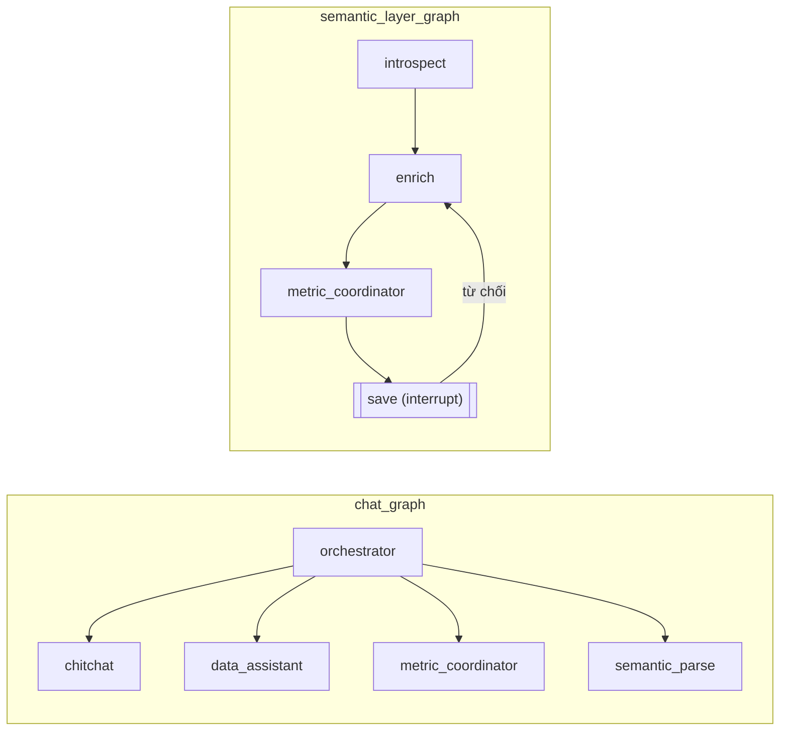

# `src/agents/graphs/` — Lắp ráp LangGraph

Mỗi file dựng một `StateGraph(AgentState)`: thêm node, nối edge, định nghĩa hàm routing rồi `compile()`. **Không chứa prompt hay logic LLM** — chỉ quyết định thứ tự và rẽ nhánh.

| File | Graph | Chức năng chi tiết |
| --- | --- | --- |
| `chat_graph.py` | `chat_agent` (`build_chat_graph`) | Đồ thị hội thoại của AI Studio. Entry là `orchestrator`; hàm `_route_by_intent` rẽ nhánh theo `intent`: `chitchat` → `chitchat`, `data_question` → `data_assistant`, `metric_query` → `metric_coordinator`, `semantic_query` → `semantic_parse`, còn `out_of_scope` kết thúc ngay (từ chối trực tiếp, không đi qua pipeline metric/query). Mọi nhánh đều kết thúc ở `END`. |
| `semantic_layer_graph.py` | `agent` (`build_graph`) | Pipeline Flow 1: `introspect → enrich → metric_coordinator → save`. `route_after_introspect` dừng sớm nếu introspect lỗi; `_route_after_review` chỉ sang `save` khi có ít nhất một đề xuất có `review.status == "pass"`. Biên dịch với **`interrupt_before=["save"]`** để dừng chờ HITL: nếu được duyệt thì lưu và kết thúc, nếu bị từ chối (`route_after_save`) thì quay lại `enrich`. |

Node cụ thể nằm ở [`../nodes/`](../nodes/README.md); agent LLM ở [`../roles/`](../roles/README.md).
